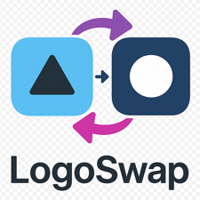

# LogoSwap

**Custom logo replacement plugin for Jellyfin 10.11+**


Replace the default Jellyfin branding with your own logo across the entire interface—no manual file editing required.


## Features

- **Simple Upload Interface** — Upload your logo directly from the Jellyfin dashboard
- **One-Click Activation** — Applies the logo through Jellyfin's Custom CSS setting
- **Jellyfin 12 Headers** — Keeps wide logos readable in the new header and drawer, including with ElegantFin
- **Custom Browser Icon** — Upload a separate PNG, ICO, or SVG favicon
- **Base URL Support** — Works at the domain root or under paths such as `/jellyfin`
- **Live Preview** — See your current logo before applying changes
- **Easy Removal** — Restore default Jellyfin branding with a single click

---

## Installation

### Via Plugin Repository (Recommended)

1. Open Jellyfin Dashboard → **Plugins** → **Repositories**
2. Click **+** to add a new repository:
   - **Name:** `LogoSwap`
   - **URL:** `https://raw.githubusercontent.com/NewsGuyTor/LogoSwap/main/manifest.json`
3. Go to **Plugins** → **Catalog**
4. Find **LogoSwap** and click **Install**
5. Restart Jellyfin

### Manual Installation

1. Download the latest release from [Releases](https://github.com/NewsGuyTor/LogoSwap/releases)
2. Extract `LogoSwap.dll` to your Jellyfin plugins directory:
   - Linux: `/var/lib/jellyfin/plugins/LogoSwap/`
   - Windows: `C:\ProgramData\Jellyfin\Server\plugins\LogoSwap\`
   - Docker: `/config/plugins/LogoSwap/`
3. Restart Jellyfin

---

## Usage

### 1. Upload Your Logo

Navigate to **Dashboard** → **Plugins** → **LogoSwap**

- Click **Select Logo Image (PNG)** and choose your logo file
- The selected image uploads automatically

> **Tip:** For best results, use a PNG with a transparent background. Recommended dimensions: 400×100px or similar wide aspect ratio.

### 2. Apply to Branding

- Click **Apply Custom Logo to Branding**
- Hard refresh your browser (`Ctrl+Shift+R` / `Cmd+Shift+R`)

Your custom logo will now appear across the main Jellyfin interface.

> **Note:** The custom logo will not appear in the Dashboard admin area, as it uses a separate interface where custom branding is not applied.

### 3. Manage Your Logo

- **Preview** — View your current uploaded logo
- **Delete Logo** — Remove your logo and restore default branding
- **Remove from Branding** — Disable the logo without deleting the file

### 4. Set a Browser Icon

- Under **Browser Icon**, select a square PNG, ICO, or SVG up to 2 MB
- Reload the page to see the new browser tab icon; a hard refresh may be needed for a cached icon
- **Restore Default Browser Icon** removes it independently of your logo

Favicons work with Jellyfin's server-hosted web client without a JavaScript injector. If you host the web client separately, point its favicon link at your server's `/logoswap/favicon` endpoint, including any configured base URL.

### Upgrading or Changing the Base URL

After upgrading LogoSwap or changing Jellyfin's Base URL, click **Apply Custom Logo to Branding** again and hard refresh. This replaces only LogoSwap's marked CSS block and preserves your other custom CSS. No base URL needs to be entered in LogoSwap.

---

## API Endpoints

| Endpoint | Method | Description |
|----------|--------|-------------|
| `/logoswap/upload` | POST | Upload a new logo (multipart/form-data) |
| `/logoswap/image` | GET | Retrieve the current logo |
| `/logoswap/delete` | DELETE | Delete the uploaded logo |
| `/logoswap/status` | GET | Check if a logo is configured |
| `/logoswap/script` | GET | Get the injection JavaScript |
| `/logoswap/styles` | GET | Get the logo stylesheet |
| `/logoswap/favicon` | POST | Upload a separate PNG, ICO, or SVG browser icon |
| `/logoswap/favicon` | GET | Retrieve the current browser icon |
| `/logoswap/favicon` | DELETE | Restore the default browser icon |

All paths are relative to Jellyfin's configured Base URL. Uploads and deletions require an authenticated administrator. Images, styles, and scripts remain public so branding can appear before login.

---

## How It Works

LogoSwap uses Jellyfin's built-in branding customization system. When you click "Apply Custom Logo to Branding", the plugin:

1. Generates CSS rules that replace logo background-images and `` content
2. Sizes wordmarks for Jellyfin 12's header and drawer instead of retaining the default square icon limits
3. Updates its marked block in Jellyfin's Custom CSS setting

Stock Jellyfin does not execute a `CustomJs` branding setting. The optional `/logoswap/script` endpoint remains available for users who run a separate JavaScript injector; it is not required for the logo or favicon.

The plugin serves the uploaded favicon in place of Jellyfin's normal `/web/favicon*.ico` response. Your original Jellyfin files are never modified, and deleting the custom icon restores the original response.

---

## Building from Source

```bash
git clone https://github.com/NewsGuyTor/LogoSwap.git
cd LogoSwap
dotnet build
```

Output: `bin/Debug/net9.0/LogoSwap.dll`

### Tests

```bash
dotnet test tests/LogoSwap.Tests.csproj
# With Playwright and Chromium already installed:
PLAYWRIGHT_MODULE=/absolute/path/to/playwright/index.mjs CHROMIUM_PATH=/usr/bin/chromium bun tests/browser.mjs
```

The API tests cover root/nested base paths, favicon upload/removal, SVG handling, and administrator permissions. The browser checks cover theme conflicts, desktop/mobile sizing, navigation, and the settings workflow.

---

## Requirements

- Jellyfin Server 10.11.0+
- .NET 9.0 Runtime (bundled with Jellyfin 10.11)

---

## Troubleshooting

**Logo not appearing after applying?**
- Hard refresh your browser (`Ctrl+Shift+R`)
- Clear browser cache
- Check Dashboard → General → Branding to verify injection is present

**Upload fails?**
- Ensure the file is PNG format
- Check Jellyfin has write permissions to its plugin config directory
- Review server logs for detailed error messages

---

## FAQ

**Why doesn't my logo appear in the Dashboard?**

The Jellyfin Dashboard admin area uses a separate interface where custom branding (Custom CSS/JS) is not applied. This is a limitation of how Jellyfin handles its admin pages. Your custom logo will appear on all regular user-facing pages.

**Can I replace the splash/loading screen logo?**

Not yet. The splash screen that appears when Jellyfin is loading is embedded in the core application and cannot be replaced via branding customization. This may be added in a future version if there's a feasible approach.

**Where is my logo stored?**

Your logo is stored in the plugin's data directory within Jellyfin's configuration folder. It's served via the `/logoswap/image` endpoint.

---

## Contributing

Bug reports, feature requests, and pull requests are welcome!

- **Found a bug?** [Open an issue](https://github.com/NewsGuyTor/LogoSwap/issues)
- **Have an idea?** [Start a discussion](https://github.com/NewsGuyTor/LogoSwap/discussions)
- **Want to contribute?** Fork the repo and submit a PR

---

## License

MIT License — see [LICENSE](LICENSE) for details.

---

**Author:** [NewsGuyTor](https://github.com/NewsGuyTor)
